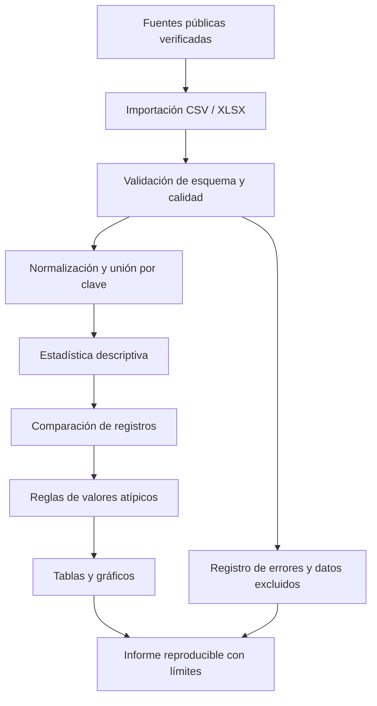

# Plan de cierre para la evaluación — Team PEAK

> Documento de trabajo consolidado. Fecha de revisión: 22 de octubre de 2026. Las fechas propuestas son una planificación de cierre y deben confirmarse con el docente. No se presentan como fechas oficialmente aprobadas.

## 1. Nombre, problema y alcance unificados

**Nombre recomendado:** Análisis estadístico de datos electorales de Bolivia (elecciones generales de 2019).

**Equipo:** Team PEAK. **Materia:** Probabilidad y Estadística, Paralelo 3, Universidad Franz Tamayo.

**Problema:** comparar registros electorales compatibles y resumir sus diferencias de manera reproducible para identificar observaciones que merezcan revisión contextual.

**Objetivo general:** desarrollar un prototipo académico en Python que importe un conjunto de datos documentado, valide su estructura, calcule estadísticas descriptivas y diferencias entre registros comparables, marque observaciones atípicas según reglas explícitas y presente tablas/gráficos.

**Fuera de alcance:** emitir conclusiones jurídicas, afirmar fraude a partir de anomalías, sustituir una auditoría electoral, autenticar actas o atribuir intencionalidad. El prototipo solo identifica señales para revisión.

**Regla de documentación:** usar el nombre anterior y el equipo Team PEAK en todos los documentos vigentes. No usar «RiskMetrics Studio» ni el alcance de desastres naturales como nombre o propósito del proyecto actual. Los archivos de `documentacion/texto/` son extracciones automáticas de originales y pueden contener versiones antiguas; no deben tomarse como fuente normativa sin cotejarlas.

## 2. Datos y trazabilidad

El repositorio consultado contiene referencias a fuentes, pero no se ha verificado todavía un dataset electoral listo para procesar. Por tanto, no se afirma que los datos hayan sido descargados, limpiados o validados.

Antes de ejecutar análisis, el equipo debe registrar en `documentacion/fuentes_datos.md`:
- institución/publicador y título exacto del conjunto o documento;
- URL directa, fecha de consulta y fecha/cobertura de los datos;
- unidad de observación (por ejemplo, acta/mesa) y campos disponibles;
- formato y licencia/condiciones de uso, cuando estén indicados;
- procedimiento de descarga, transformaciones y suma de comprobación opcional;
- limitaciones, campos ausentes y cómo se enlazan los registros entre fuentes.

Fuentes a verificar por el equipo: Órgano Electoral Plurinacional (resultados y documentos oficiales); documentación pública sobre TREP y cómputo oficial; informes públicos de observación electoral pertinentes, incluida la OEA si se usa. Las referencias a informes de prensa o al caso público de Edgar Villegas sirven como contexto, no reemplazan los datos primarios. No registrar una fuente como utilizada hasta comprobar su URL y contenido.

### Validaciones mínimas de entrada
1. Comprobar columnas requeridas, tipos y formato de identificadores.
2. Informar filas duplicadas, campos faltantes y valores no numéricos; no borrarlos silenciosamente.
3. Verificar rangos plausibles y consistencia de totales cuando los campos existan.
4. Para comparar dos fuentes, definir una clave de unión y reportar registros sin pareja; no comparar filas solo por posición.
5. Guardar un resumen de filas de entrada, excluidas y analizadas.

## 3. Fórmulas y reglas estadísticas propuestas

Estas fórmulas son una especificación inicial del prototipo, no resultados ya calculados. Aplicarlas únicamente a variables numéricas comparables y documentar el tamaño de muestra.

Para una variable (x_1,\ldots,x_n):
- Media: \(\bar{x}=\frac{1}{n}\sum_{i=1}^{n}x_i\).
- Desviación estándar muestral: \(s=\sqrt{\frac{1}{n-1}\sum_{i=1}^{n}(x_i-\bar{x})^2}\), para \(n\ge 2\).
- Diferencia entre dos fuentes: \(d_i=B_i-A_i\); diferencia absoluta: \(|d_i|\).
- Diferencia porcentual: \(100\frac{B_i-A_i}{A_i}\), solo cuando \(A_i\ne0\). Si \(A_i=0\), marcar como no definida y reportarla aparte.
- Z-score: \(z_i=(x_i-\bar{x})/s\), solo si \(s>0\).
- Regla inicial de revisión: marcar \(|z_i|\ge3\) como señal estadística para inspección, no como prueba de error o manipulación. Si \(s=0\), no calcular z-score.
- Regla robusta opcional: IQR = Q3 − Q1; marcar valores menores que \(Q1-1.5\,IQR\) o mayores que \(Q3+1.5\,IQR\). Indicar método de cálculo de cuartiles usado por la librería.

Las reglas deben ejecutarse sobre la variable elegida (por ejemplo, diferencia de votos de una candidatura entre dos registros enlazados), no sobre columnas heterogéneas mezcladas. Antes de interpretar, revisar tamaño de muestra, sesgo de selección, cambios de metodología y calidad de la unión. El umbral \(|z|\ge3\) es convencional y exploratorio; no tiene significado jurídico ni causal.

## 4. Arquitectura propuesta

El siguiente diagrama describe una arquitectura lógica propuesta; no implica que todos sus componentes estén implementados todavía.

**Interfaces entre módulos:** la importación produce una tabla estructurada; la validación devuelve datos aceptados y un reporte de incidencias; el análisis recibe únicamente campos documentados; la salida incluye indicadores, filas señaladas y motivo de cada señal. La interfaz visual se considera una capa de presentación opcional hasta confirmar la tecnología y el código existentes.

## 5. Pruebas y criterios de aceptación

Registrar para cada prueba: identificador, datos de entrada, resultado esperado, resultado observado, estado (aprobada/fallida), fecha y responsable.

| ID | Prueba | Criterio verificable de aceptación |
| --- | --- | --- |
| P01 | Importación de archivo válido | El archivo se lee y el número de filas importadas coincide con el archivo de prueba. |
| P02 | Columnas requeridas ausentes | El sistema informa claramente las columnas faltantes y no produce un análisis como si la entrada fuera válida. |
| P03 | Duplicados y valores faltantes | El reporte cuenta los casos; no se eliminan silenciosamente. |
| P04 | Diferencias conocidas | Para un pequeño fixture manual, cada diferencia calculada coincide con el valor esperado. |
| P05 | Porcentaje con denominador cero | El resultado se marca como no definido; no se genera infinito ni una división por cero. |
| P06 | Z-score con dispersión cero | El sistema evita dividir por cero y explica que la regla no aplica. |
| P07 | Umbral de anomalía | En un fixture numérico diseñado para la prueba, la regla marca exactamente los casos previstos por el umbral configurado. |
| P08 | Unión entre fuentes | Se informa cuántos registros emparejan y cuántos quedan sin correspondencia. |
| P09 | Reproducibilidad | Con la misma entrada, configuración y versión, se obtienen los mismos indicadores y marcas. |
| P10 | Gráficos/salida | Los títulos, unidades, número de observaciones y variables coinciden con el análisis generado. |

No declarar «porcentaje de acierto» sin un conjunto etiquetado de referencia y una definición de verdadero positivo/falso positivo. Si no existe ese conjunto, evaluar corrección matemática, reproducibilidad y trazabilidad, no precisión predictiva.

## 6. Responsabilidades propuestas

Los nombres completos que aparecen en la documentación de portada son Sebastian Matias Alba Ordoñez, Hugo Santiago Gutierrez Martinez y Gabriel Santiago Rivero Rico. En documentos extraídos aparecen formas abreviadas como «Matias Alba», «Hugo Gutierrez» y «Santiago Rivero». Confirmar con el equipo que los alias correspondan a las mismas personas antes de asignar tareas en GitHub.

- **Hugo Santiago Gutierrez Martinez:** coordinación, búsqueda y registro de fuentes, contexto del caso, seguimiento del cronograma y redacción del informe.
- **Sebastian Matias Alba Ordoñez:** fórmulas, validación de datos, procesamiento estadístico en Python y pruebas numéricas.
- **Gabriel Santiago Rivero Rico:** presentación de tablas/gráficos, integración de la interfaz si se confirma su alcance, pruebas de visualización y documentación de uso.
- **Todo el equipo:** revisión cruzada, decisiones de alcance, validación final y exposición.

Estas son asignaciones de trabajo sugeridas a partir de los roles descritos en los documentos, no una confirmación de aceptación individual. Cada tarea debe quedar en un Issue con un único responsable una vez que el equipo confirme las cuentas de GitHub.

## 7. Cronograma de cierre propuesto

Fechas propuestas a partir del 22 de octubre de 2026; deben cotejarse con el plazo oficial del docente. Si el plazo real es distinto, actualizar este calendario antes de presentarlo.

| Fechas propuestas | Actividad y entregable | Responsable principal |
| --- | --- | --- |
| 22–23 oct. | Unificar nombre, alcance y lista de documentos vigentes; registrar decisiones | Hugo + todo el equipo |
| 22–24 oct. | Verificar fuentes y documentar dataset disponible o dejar constancia de bloqueo | Hugo |
| 24–26 oct. | Especificación de variables, fórmulas y umbrales | Matias |
| 26–27 oct. | Diagrama de arquitectura y contratos entre módulos | Matias + Gabriel |
| 27–30 oct. | Implementación mínima y pruebas P01–P08 según datos disponibles | Matias + Gabriel |
| 30 oct.–2 nov. | Integración, reproducibilidad y pruebas P09–P10 | Todo el equipo |
| 2–4 nov. | Informe, tablas/gráficos y limitaciones documentadas | Hugo + todo el equipo |
| 5 nov. | Revisión cruzada y corrección de observaciones | Todo el equipo |
| 6 nov. | Demostración y entrega, únicamente si coincide con la fecha oficial | Todo el equipo |

## 8. Lista de cierre para la aprobación

- [ ] Confirmar nombre, alcance y nombres completos en los documentos originales.
- [ ] Verificar y registrar las fuentes concretas y el dataset que realmente se utilizará.
- [ ] Revisar las fórmulas con ejemplos manuales y documentar las reglas.
- [ ] Adaptar el diagrama a la arquitectura realmente implementada.
- [ ] Ejecutar y adjuntar evidencias de las pruebas; no marcar como aprobadas antes de correrlas.
- [ ] Confirmar integrantes/cuentas de GitHub y crear Issues con responsables.
- [ ] Confirmar las fechas con el docente y actualizar el cronograma.
- [ ] Revisar las extracciones automáticas en `documentacion/texto/` contra los documentos originales antes de usarlas como entregables.

## Limitaciones actuales conocidas

En la inspección de este plan no se verificó un dataset electoral listo para procesar ni una aplicación funcional completa. Las fórmulas, el diagrama, los criterios y el calendario son propuestas documentadas para cerrar los vacíos de evaluación; deben contrastarse con el código, las fuentes y las fechas oficiales antes de afirmar que se implementaron.
